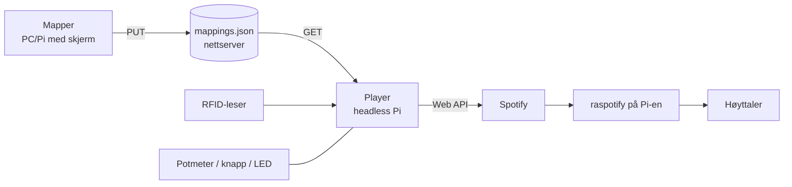
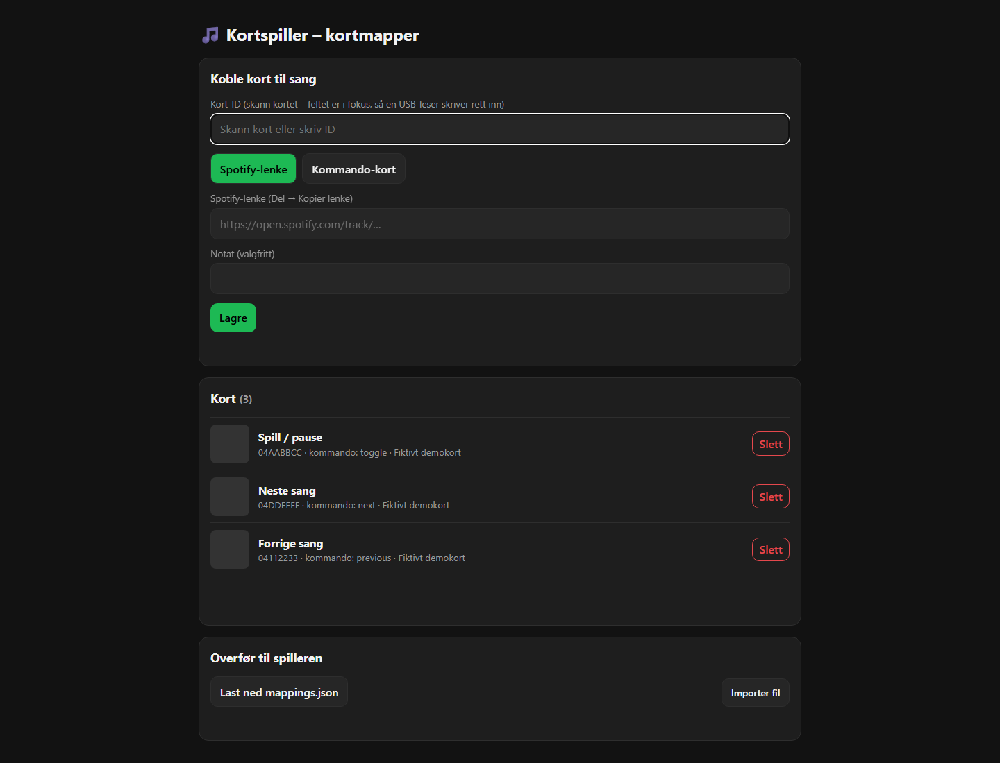
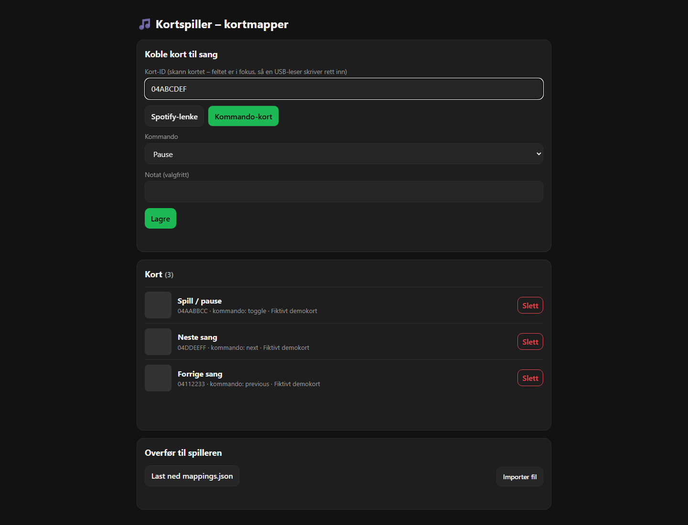

# Kortspiller – RFID-kort som spiller Spotify

Hold et RFID-kort mot leseren, og sangen du har koblet til kortet starter på Spotify.

| Del | Hva | Hvor kjører den |
|---|---|---|
| **Mapper** (`src/KortSpiller.Mapper`) | Nettside på localhost der du skanner kort og limer inn Spotify-lenke. Lagrer `mappings.json`. | PC eller Raspberry Pi med skjerm/mus/tastatur |
| **Player** (`src/KortSpiller.Player`) | Bakgrunnstjeneste uten skjerm. Leser kort, volum-potmeter og pauseknapp, og styrer Spotify. | Headless Raspberry Pi (autostart) |
| `mappings.json` | `kort-ID → spotify:track:…` (eller kommando som pause/neste) | Nettserver, Azure Blob, gist – eller bare kopiert med `scp` |
| raspotify | Gjør Pi-en til en Spotify Connect-enhet («Kortspiller») som faktisk spiller lyden | Samme Pi som Player |



Se også `docs/arkitektur.svg`, `docs/kobling-rc522.svg` og `docs/kobling-pn532.svg`.

**Full oppsettsguide for Raspberry Pi: [`docs/RASPBERRY-PI-OPPSETT.md`](docs/RASPBERRY-PI-OPPSETT.md)**

## Hurtigstart på PC (uten maskinvare)

Krever .NET 10 SDK og NuGet-tilgang ved første bygg. Kopier eksempelkonfigurasjonen til hver app før oppstart:

```powershell
# 1. Mapper
cd src\KortSpiller.Mapper
Copy-Item appsettings.example.json appsettings.json
dotnet run          # åpne http://localhost:5050

# 2. Player med «kort» skrevet i terminalen
cd ..\KortSpiller.Player
Copy-Item appsettings.example.json appsettings.json
$env:KORTSPILLER_Player__Readers__0__Type = 'Console'
dotnet run -- auth --manual     # én gang: logg inn på Spotify (se guiden)
dotnet run                      # skriv kort-ID og trykk Enter
```

## Konfigurasjon (`appsettings.json`)

Begge appene har en renset `appsettings.example.json`, som kopieres til en lokal `appsettings.json`. Ekte konfigurasjon, tokenfiler og `data/` er utelatt fra Git. Player leser også `appsettings.local.json` etter `appsettings.json` og miljøvariabler med prefiks `KORTSPILLER_`, for eksempel `KORTSPILLER_Spotify__ClientId`. Mapper bruker standard .NET-konfigurasjon: legg lokale verdier i dens `appsettings.json` eller bruk miljøvariabler uten prefiks, for eksempel `Mapper__Publish__BearerToken`. Mapper leser ikke `appsettings.local.json` automatisk.

Den rensede Player-konfigurasjonen bruker `data/mappings.json` som lokal kilde. Eksporter filen fra Mapper og kopier den til denne stien, eller sett `Mapping:Source` til din egen kilde. Før Spotify-avspilling må `Spotify:ClientId` fylles inn, Spotify-innlogging gjennomføres og en Connect-enhet være tilgjengelig. Mapper kan brukes uten Spotify-innlogging og RFID-maskinvare.

## Eksempelbilder

Bildene viser Mapper med fiktive kort-ID-er og kommandokort. Ingen Spotify-token, ekte RFID-kort eller eksterne publiseringsadresser inngår.





### Player

| Nøkkel | Betydning |
|---|---|
| `Spotify:ClientId` | Client ID fra Spotify Developer Dashboard (ingen client secret trengs – PKCE) |
| `Spotify:DeviceName` | Navn på Connect-enheten, må være lik `LIBRESPOT_NAME` i raspotify |
| `Spotify:TokenFile` | Hvor refresh-token lagres (lages av `auth`) |
| `Mapping:Source` | URL (`https://…/mappings.json`) eller filsti |
| `Mapping:RefreshSeconds` | Hvor ofte filen sjekkes (ETag, billig) |
| `Mapping:BearerToken` / `Mapping:Headers` | Valgfritt, for beskyttet kilde |
| `Player:Readers` | Liste med lesere. `Type`: `Mfrc522`, `Pn532`, `UsbKeyboard`, `Console` |
| `Volume:*` | MCP3008-potmeter (`Enabled`, `Channel`, `ChipSelect`) |
| `PauseButton:*` / `StatusLed:*` | `Enabled` og `Pin` (BCM-nummer) |

### Mapper

| Nøkkel | Betydning |
|---|---|
| `Mapper:MappingFile` | Hvor mappingfilen lagres lokalt |
| `Mapper:Reader` | Valgfri leser på samme maskin (samme felter som over). Gir «Skann»-knapp |
| `Mapper:Publish:Url` | Hvis satt, vises «Publiser» (HTTP PUT av filen), f.eks. Azure Blob SAS-URL |
| `Mapper:Publish:Headers` | f.eks. `{ "x-ms-blob-type": "BlockBlob" }` for Azure Blob |

## Kommando-kort

I mapperen kan et kort i stedet få en kommando: `pause`, `resume`, `toggle`, `next`, `previous`.
Kommando-kort er et fint bruksområde for en ekstra leser (se guiden, «Forslag til bruk av begge leserne»).

## Bygg og pakk

```powershell
dotnet test
.\deploy\publish.ps1            # lager dist\pi (Player), dist\mapper-win-x64 og dist\mapper-linux-arm64
```

## Status / begrensninger

Bygg og alle 11 tester besto 11. november 2026. Mapper er kontrollert lokalt med kommandokort og renset konfigurasjon. Spotify-innlogging og fysisk maskinvare er ikke verifisert i denne kontrollen.

* Kompilert og enhetstestet på Windows (parsing, kort-ID, mappingfil, Spotify-klient mot falsk server) og røyktestet
  (mapper-API, player med konsoll-leser). **Maskinvaren (RC522/PN532/MCP3008/GPIO) er ikke testet på ekte Pi** –
  forvent litt justering av pinner/innstillinger.
* Spotify **Premium** kreves for å styre avspilling via Web API.
* Eagle-filer er ikke laget; kobling er dokumentert som SVG og pinnetabeller.
